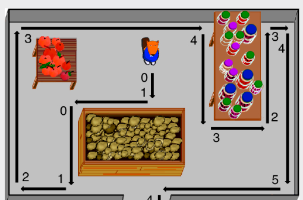

Antwort A ist richtig:

## Das ist Informatik!

Die Regeln des Bibers beschreiben eine bestimmte systematische Art, sich in einem Irrgarten (Labyrinth) zu bewegen. Sie könnte z.B. für Roboter in entsprechenden Situationen nützlich sein. Die Informatik kennt diese Art unter dem Namen „Pledge-Algorithmus“. Und sie kennt noch weitere Wege aus dem Dunkeln: <http://de.wikipedia.org/wiki/Lösungsalgorithmen_für_Irrgärten>
