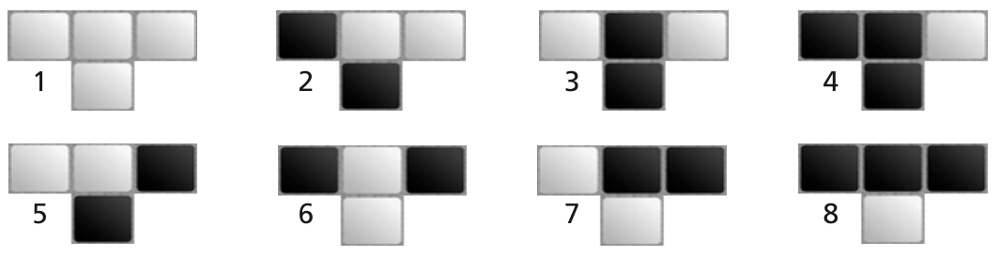

Kachelfreund renoviert sein Badezimmer und verlegt schwarze und weiße Kacheln. Dabei will er je drei nebeneinander liegende Kacheln und die Kachel in der Mitte darunter ausschließlich nach bestimmten Mustern verlegen. Nur die folgenden acht Kachelmuster sind erlaubt:

Der etwas eigenwillige Kachelfreund hat nun an vier Stellen im Bad bereits Kacheln verlegt. Dabei hat er, wie unten zu sehen ist, immer drei Kachelpositionen frei gelassen. Schon jetzt ist klar, dass es an einer Stelle **nicht** mehr möglich ist, die drei freien Positionen so mit Kacheln zu füllen, dass die Kachelmuster eingehalten werden.

**An welcher Stelle?**
