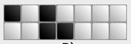
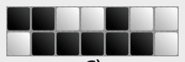
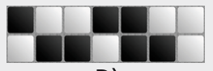

Die Stelle A lässt sich nicht gemäß der Muster füllen. Die linke unbekannte Kachel müsste nämlich gemäß Muster 3 weiß sein. Die mittlere unbekannte Kachel müsste dann gemäß Muster 6 schwarz sein. Die rechte unbekannte Kachel müsste dann gemäß Muster 7 schwarz sein. Dann gibt es aber kein passendes Muster, bei dem diese schwarze Kachel links oben liegt.

Die Lösungen für B bis D:

  

## Das ist Informatik!

Die Welt ist ständig in Bewegung, und so muss auch die Informatik in der Lage sein, dynamische Systeme modellieren zu können – zum Beispiel mit „zellulären Automaten“. Die bestehen aus vielen kleinen Zellen, deren Zustand sich mit der Zeit verändert, in Abhängigkeit von ihrer Nachbarschaft. Die Kachelmuster beschreiben einen einfachen zellulären Automaten mit einer Reihe von Zellen und einer Nachbarschaft von drei Zellen. Jedes Muster gibt für einen der 8 möglichen Nachbarschaftszustände den Folgezustand der Zelle in der Mitte an. Es kann 256 verschiedene solcher Automaten geben (warum?). Unter diesen scheint Automat Nr. 30 besondere Eigenschaften zu haben. Geheimnisvolle Informatik! <http://en.wikipedia.org/wiki/Rule_30>
