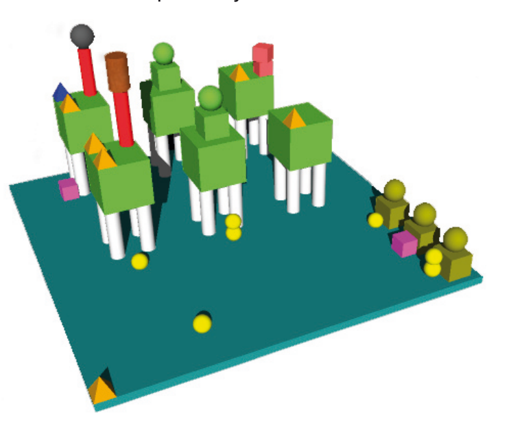

Der Biber soll in einer automatischen Fabrik ein defektes Teil auswechseln und bekommt dazu folgende Anleitung:

- Ein WürKu ist ein Würfel, auf dessen Oberseite eine Kugel sitzt.
- Ein VierZyl besteht aus einem großen Würfel, der auf vier Zylindern steht.
- An der vorderen Kante der Plattform sitzt eine Pyramide.
- An derselben Kante der Plattform sitzt ein WürKu.
- Unmittelbar neben diesem WürKu sitzt ein weiterer WürKu.
- Dieser WürKu ist mit einem Ding des Typs X verbunden.
- Es gibt genau einen VierZyl, an dem sich unten ein Ding vom Typ X befindet. Dieser VierZyl heißt vz-1.
- Auf der Oberseite von vz-1 sitzen p-zahl Pyramiden.
- Es gibt noch einen anderen VierZyl, auf dem ebenfalls p-zahl Pyramiden sitzen. Dieser VierZyl heißt vz-2.

Ersetze das Teil, das sich in der höchsten Position über vz-2 befindet.

**Was für ein Teil ist das?**
