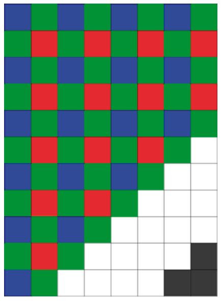

Hier siehst du ein teilweise gefärbtes Raster mit 8 mal 11 Quadraten. Beachte das Farbmuster!

- In der ersten Zeile sind die Quadrate abwechselnd blau und grün.
- In der zweiten Zeile sind die Quadrate abwechselnd grün und rot.
- In der dritten Zeile sind die Quadrate wieder abwechselnd blau und grün.
- Und so weiter.

Angenommen, das ganze Raster wird mit diesem Farbmuster gefüllt, welche Farben bekommen dann die drei grauen Quadrate in der rechten unteren Ecke?
