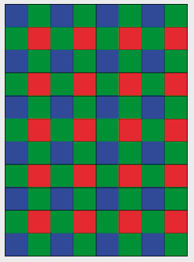

Die Antwort D ist richtig:

## Das ist Informatik!

Damit ein Programm anspruchsvollere Aufgaben erledigen kann, muss die Informatik vorher viel Klugheit einprogrammieren. Man könnte in dieser Aufgabe natürlich einfach alle Quadrate der Reihe nach einfärben. Das würde bei einem sehr großen Raster länger dauern. Wenn das Programm ein wenig „nachdenken“ könnte, käme es vielleicht sehr viel schneller auf diese Idee: „In der letzten Spalte kommt nur blau und grün vor, in der letzten Zeile kommt nur rot und grün vor. Welche Antwortalternative erfüllt diese Bedingung?“ Seit ihren Anfängen arbeitet die Informatik an dem Problem, „Klugheit“ zu erzeugen.
