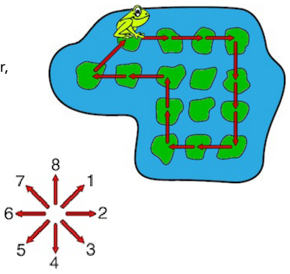

Ein Frosch will vor Freude herumhüpfen. In seinem Teich sind etliche Seerosenblätter, auf einem sitzt der Frosch. Er hüpft nun so von Blatt zu Blatt, wie es im Bild zu sehen ist. Am Ende sitzt der Frosch wieder dort, wo er losgehüpft ist.

Die acht möglichen Hüpfrichtungen des Froschs sind so nummeriert: 1 nach rechts oben, 2 nach rechts, 3 nach rechts unten, 4 nach unten, 5 nach links unten, 6 nach links, 7 nach links oben, 8 nach oben. Mit den Nummern kann man Hüpfwege beschreiben.

**Welchen Weg ist der Frosch gehüpft?**
