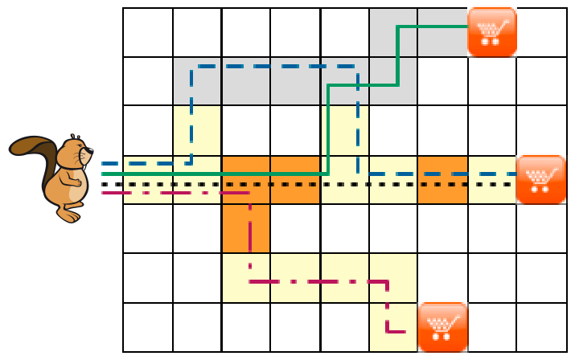
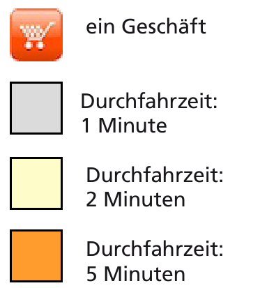

Herr Biber ist oft hungrig. Dann möchte er schnell mit dem Fahrrad in ein Geschäft fahren, um ein paar Nüsse zu kaufen.

Dazu hat er eine besondere Karte. Deren Planquadrate sind auf verschiedene Weise markiert. In einigen sind die Geschäfte eingezeichnet, zu denen Herr Biber fahren kann. Für andere Planquadrate gibt deren Farbe an, wie lange Herr Biber benötigt, um das Quadrat zu durchfahren – wegen des unterschiedlichen Geländes kommt er nicht überall gleich schnell voran.

Hier siehst du die Karte und die Bedeutung der Markierungen:

**Auf welchem Weg kommt Herr Biber am schnellsten zu einem Geschäft?**
