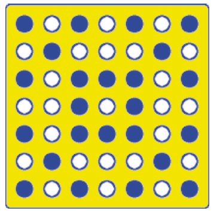

Ein neues Schließsystem wird im Hotel Biber eingeführt. Der Gast erhält eine quadratische Plastikkarte mit 7 mal 7 Codepunkten. An jedem Codepunkt ist entweder ein Loch oder kein Loch.

Hier ist ein Beispiel einer Plastikkarte:

Im Zimmerschloss ist ein Codeleser. Die Codierung der Plastikkarte ist vorne und hinten, längs und quer symmetrisch. Es ist also egal, mit welcher Ausrichtung der Gast die Plastikkarte ins Zimmerschloss steckt.

**Wie viele verschiedene Plastikkarten kann es geben?**
