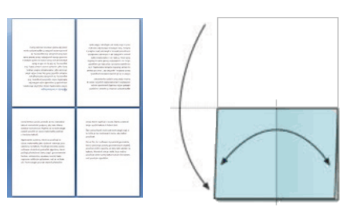

Ein Drucker will ein Heft mit acht Seiten herstellen; aus einem großen Blatt Papier, dem Druckbogen.

Der Druckbogen wird vorne und hinten bedruckt. Dann wird er zweimal gefaltet, einmal längs und einmal quer. Dann werden alle vier Ränder beschnitten, so dass der Leser die Seiten wie gewohnt umblättern kann.

Der Drucker überlegt, wie er die acht Seiten auf dem Druckbogen anordnen kann. Die Seiten sollen sich nach einer passenden Faltung im fertigen Heft in der richtigen Reihenfolge befinden.

Der Drucker hat vier Anordnungen vorbereitet. Wir sehen zwar die Druckbögen nur von vorne, können aber klar erkennen, dass eine Anordnung falsch ist.

**Welche Anordnung ist falsch?**
