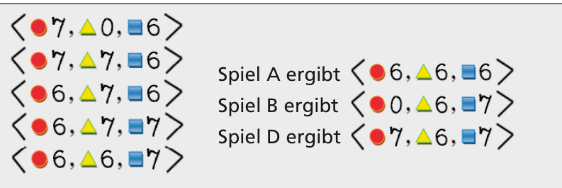

Die Folge der Änderungen ist: ⟨rot 7, gelb 0, blau 6⟩, ⟨rot 7, gelb 7, blau 6⟩, ⟨rot 6, gelb 7, blau 6⟩, ⟨rot 6, gelb 7, blau 7⟩, ⟨rot 6, gelb 6, blau 7⟩. Spiel A ergibt ⟨rot 6, gelb 6, blau 6⟩, Spiel B ergibt ⟨rot 0, gelb 6, blau 7⟩, Spiel D ergibt ⟨rot 7, gelb 6, blau 7⟩.

## Das ist Informatik!

Beim Programmieren unverzichtbar ist die „Variable“. Sie ist ein ziemlich komplexes Konzept. Zum Beispiel muss der Variablen ein „Identifier“ gegeben werden. Der muss im die Variable einschließenden Programm-„Block“ eindeutig sein. Die Variable trägt einen aktuellen Wert, aus einer Menge zulässiger „Werte“, ihrem „Datentyp“. Der „Variablenwert“ kann explizit durch „Zuweisungen“ verändert werden, aber auch implizit als „Seiteneffekt“ anderer Programmbefehle. Wird der Wert geändert, geht das Wissen über den vorherigen Variablenwert verloren.
