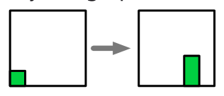

Der Biber liebt die Vegetation. Er hat eine Programmiersprache erfunden, die mit der Idee pflanzlichen Wachsens spielt. Man programmiert aus visuellen Objekten Bilder. Ein visuelles Objekt kennt drei Operationen: „dopple“, „teile“ und „stirb“. Jedes Bild beginnt mit einem quadratischen Objekt „a“.

Zum Beispiel: Das folgende Programm mit den fünf Operationen

`a.dopple(rechts); a.dopple(rechts); [b,c] ← a.teile(); c.dopple(hoch); b.stirb();`

erzeugt diese Folge von Bildern:

Nur ein Objekt, das kein Quadrat ist, kann die teile()-Operation ausführen. Dabei wird es quer zur Längsrichtung in zwei neue, kürzere Objekte gespalten.

Der Biber möchte ein Programm schreiben, welches das linke Bild in das rechte Bild überführt:

**Was könnten die ersten Anweisungen dieses Programms sein?**
