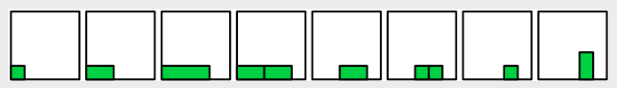

Ein vollständiges Programm für A lautet:

`a.dopple(rechts); a.dopple(rechts); [b,c] ← a.teile(); b.stirb(); [d, e] ← c.teile(); d.stirb(); e.dopple(hoch);`

B und D führen schnell zu einem Quadrat mit Seitenlänge von mindestens zwei Einheiten. Es ist dann nicht mehr möglich, ein solches Objekt zu teilen und ein schmaleres Rechteck abzuleiten. Ein Gärtner muss bei der Gartenpflege auf das Unkraut aufpassen!

## Das ist Informatik!

Die Informatik benutzt in ihren Problemstellungen und Programmiersprachen gern Metaphern. Das soll es den entwickelnden und benutzenden Menschen leichter machen, mit den eigentlich sehr abstrakten Verfahren umzugehen. Die Programmiersprache LOGO etwa benutzt die Metapher einer Schildkröte, die über den Bildschirm wandert und dabei eine Spur hinterlässt. Unsere Aufgabe basiert auf einer Pflanzen-Metapher. Die Pflanze hat zwar keine Beine, aber sie kann wachsen, sich teilen und in Teilen absterben. So kann auch eine Fortbewegung erreicht werden – etwa für eine spezielle Art von Kriechroboter.
