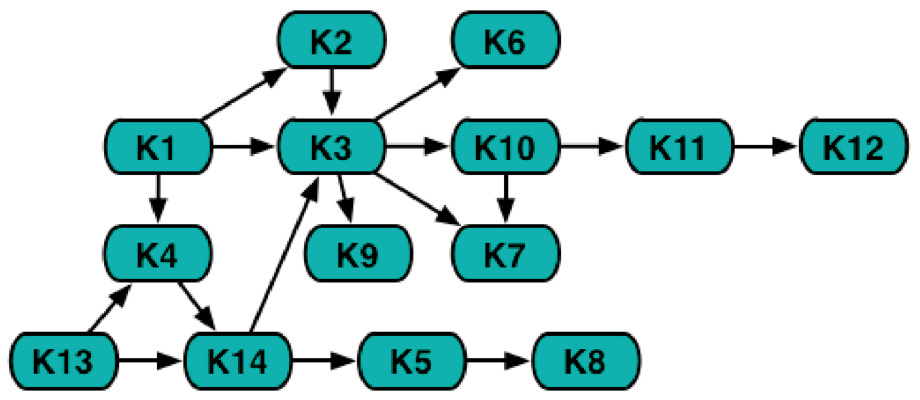

Eine Universität bietet dreimonatige Kurse an. Einige Kurse kann man aber erst dann besuchen, wenn man einen oder mehrere andere Kurse bereits absolviert hat. Die Abfolge der Kurse wird in diesem Diagramm mit Hilfe von Pfeilen dargestellt:

Kurs K1 kann man beispielsweise sofort besuchen. Kurs K4 kann man erst dann besuchen, wenn man die Kurse K1 und K13 bereits absolviert hat. Soweit die im Diagramm dargestellten Bedingungen das zulassen, können Kurse parallel besucht werden.

**Wie viele Monate benötigt man mindestens, um alle Kurse zu absolvieren?**
