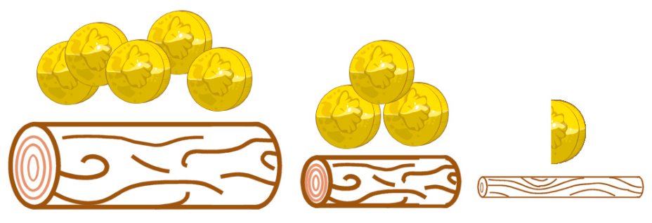

Benny soll Hölzer aus dem Wald holen. Sie werden für den Damm gebraucht.

Für schwere Hölzer mit 3 Kilo Gewicht bekommt Benny am meisten ausbezahlt, nämlich 5 Münzen. Für mittelschwere Hölzer mit 2 Kilo Gewicht bekommt er 3 Münzen. Und leichte Hölzer mit 1 Kilo Gewicht sind nur eine halbe Münze wert.

Benny kann nur einmal in den Wald gehen und nicht mehr als 7 Kilo tragen.

**Welche Hölzer wird Benny holen, damit er möglichst viele Münzen verdient?**
