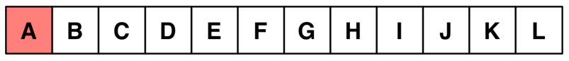

Bei einem Schachturnier treffen Teams aufeinander. Jedes Team hat sechs Spieler; drei davon spielen mit weißen Figuren, die drei anderen spielen mit schwarzen Figuren. Über die Begegnung der beiden besten Teams ist Folgendes zu erfahren:

- Die Spieler A, B, C, D, E und F spielen mit weißen Figuren, die Spieler G, H, I, J, K und L spielen mit schwarzen Figuren.
- Spieler A spielt gegen Spieler H, K spielt gegen E, C gegen I und F gegen G.
- Folgende Spielerpaare sind jeweils aus dem gleichen Team: B und C, I und J, H und B, C und G.
- Die Spieler L und G sind aus verschiedenen Teams.

In der Grafik sollen die Teamkameraden von Spieler A rot und die Spieler des gegnerischen Teams grün gefärbt werden.

**Welche der folgenden Färbungen ist die richtige?**
