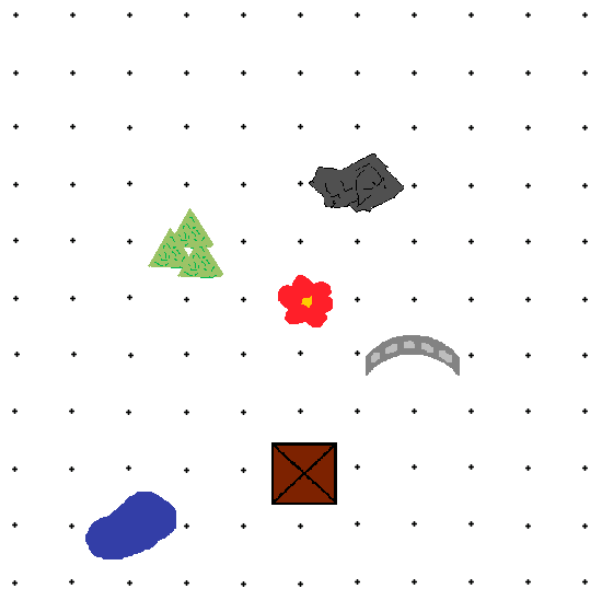

Biber Greta hat eine Schatzkarte und sie weiß die Schatzposition: (7|4). Aber sie hat vergessen, bei welcher Ecke die Position (0|0) ist.

Sie erinnert sich nur noch, dass die Blumen (rote Blume) bei (5|5) blühen und der Tümpel (blauer Fleck) bei (1|8) liegt.

**Wo mag der Schatz versteckt sein?**
