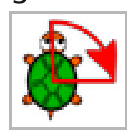
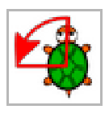
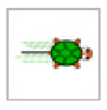

Du hast einen Schildkrötenroboter zum Geburtstag bekommen, der folgende einfache Anweisungen ausführen kann:

 Drehe dich um 90 Grad nach rechts

 Drehe dich um 90 Grad nach links

 Fahre 30 Zentimeter vorwärts

Der Schildkrötenroboter ist so gemacht, dass er eine ihm gegebene Folge von Anweisungen solange wiederholt, bis man ihn ausschaltet.

**Welche Folge von Anweisungen lässt den Schildkrötenroboter ein Quadrat fahren?**
