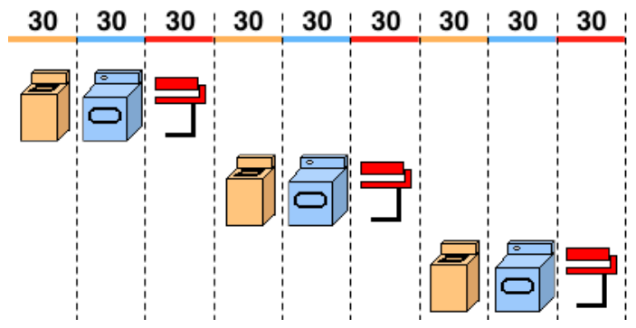

Johannes Biber hat eine neue Wäscherei eröffnet. Er hat drei Maschinen: eine Waschmaschine, einen Wäschetrockner und eine Bügelmaschine. Jede Maschine braucht genau 30 Minuten für ihren Arbeitsgang. Ein Kunde, der allein in der Wäscherei ist, benötigt also 90 Minuten, um seine Wäsche komplett mit allen drei Arbeitsgängen (Waschen, Trocknen, Bügeln) zu erledigen.

Drei Kunden kommen gleichzeitig und möchten ihre Wäsche möglichst schnell erledigen. Sie könnten die Maschinen so benutzen, wie im Bild gezeigt: Erst wenn ein Kunde seine Wäsche komplett erledigt hat, ist der nächste dran. Aber es geht schneller; schließlich können die Maschinen gleichzeitig laufen.

**Wie viele Minuten dauert es wenigstens, bis alle drei ihre Wäsche komplett erledigt haben?**
