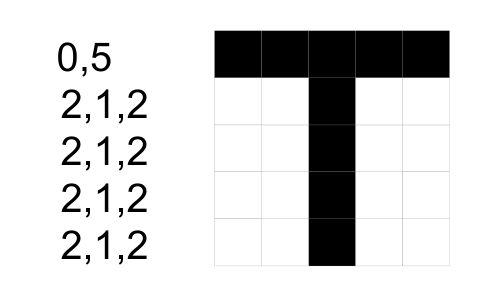

In einem Computer gespeicherte Bilder werden normalerweise durch ein Raster von Punktinformationen beschrieben: den „Pixeln“. Die Pixel von Schwarzweißbildern sind entweder „schwarz“ oder „weiß“.

Schwarzweißbilder können auch zeilenweise von links nach rechts mit Zahlen beschrieben werden. Zuerst kommt die Anzahl zusammenhängender weißer Pixel, dann die Anzahl der darauf folgenden zusammenhängenden schwarzen Pixel, dann wieder der weißen Pixel, usw.

Ein Beispiel: Das Bild von „T“ hat in seiner ersten Zeile 0 weiße Pixel und dann 5 schwarze Pixel. Die weiteren Bildzeilen beginnen mit 2 weißen Pixeln, es folgen 1 schwarzes und 2 weiße Pixel.



Auch die folgenden Zahlen beschreiben ein Schwarzweißbild:

```
0, 1, 3, 1
0, 1, 3, 1
0, 5
0, 1, 3, 1
0, 1, 3, 1
```

**Welchen Buchstaben zeigt dieses Bild?**
