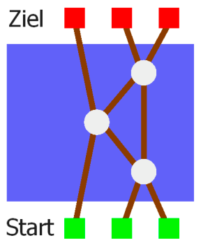

Unten am Fluss spielen drei Biber das Spiel „Sortierende Brücken“. Sie haben sich ein Netzwerk gebaut – siehe das Bild. Das Netzwerk besteht aus Plätzen: den grünen Startplätzen am unteren Ufer, den roten Zielplätzen am oberen Ufer und den Steinen im Fluss. Diese Plätze sind durch einige Bretter verbunden.

Anfangs steht jeder Biber auf einem Startplatz. Von einem Platz aus darf er nur in Richtung Ziel über das Brett zu einem benachbarten Platz gehen. Wenn ein Biber als erster auf einen Stein kommt, wartet er dort auf einen weiteren Biber. Wenn dann zwei Biber auf dem Stein stehen, geht der kleinere Biber über das linke Brett weiter, der größere Biber nimmt das rechte Brett.

Egal wie die Biber sich am Start aufgestellt haben, am Ziel sind sie immer der Größe nach sortiert. Links steht der kleinste Biber und rechts steht der größte. Das finden sie lustig.

Da kommt ein vierter Biber und will mitspielen. Nun brauchen sie ein neues Netzwerk, mit dem vier Biber sortiert werden können. Die Biber probieren vier verschiedene Netzwerke aus.

**Aber nur eines funktioniert richtig. Welches?**
