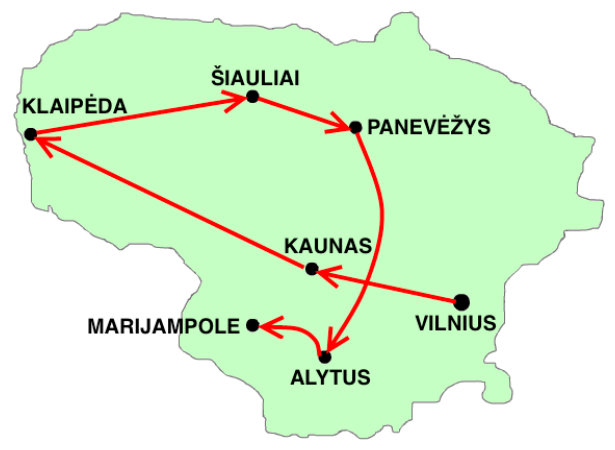
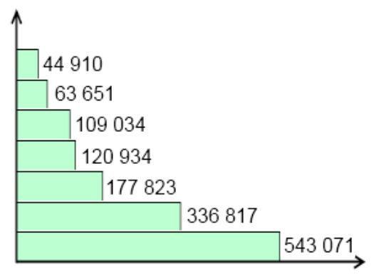

Auf der Landkarte (links) ist eine Reise durch die wichtigsten Städte von Litauen eingetragen. Die Reise beginnt in der Stadt mit den meisten (543 071) Einwohnern: Vilnius. Von dort führt die Reise in absteigender Reihenfolge bis zur Stadt mit den wenigsten Einwohnern.

Das Balkendiagramm (rechts) zeigt die Einwohnerzahlen der Städte. Die Städtenamen aber fehlen.

**Wie viele Einwohner hat Alytus?**
