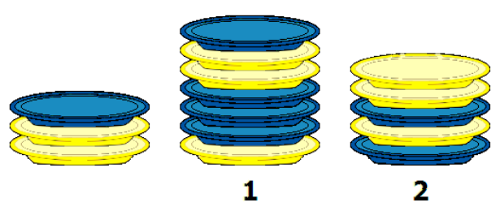

Unser Roboter kann vom linken Stapel einen Teller nehmen und ihn entweder auf dem Stapel 1 oder dem Stapel 2 ablegen.

Er kann dazu mit einer Folge der Zahlen 1 und 2 programmiert werden. Die Zahlen weisen ihn an, wie er nacheinander den jeweils obersten Teller des linken Stapels entweder auf dem Stapel 1 oder auf dem Stapel 2 ablegen soll.

Der Roboter hat gerade dieses Programm erfolgreich ausgeführt: „2 1 2 1 1 2 1“. Die Stapel sehen jetzt wie folgt aus:

**Wie haben die Stapel ausgesehen, bevor unser Roboter das Programm ausgeführt hat?**
