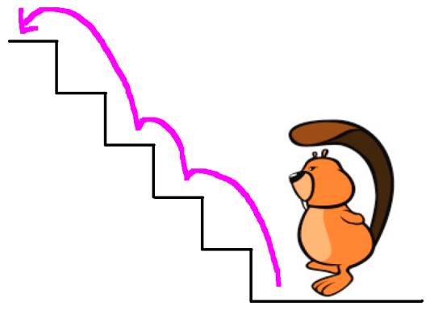

Der kleine Biber wohnt im ersten Stock. Eine Treppe mit fünf Stufen führt hinauf. Dem kleinen Biber ist es langweilig, immer jede Stufe einzeln zu hopsen. Er will manchmal auch zwei Stufen mit einem Hops nehmen.

Er könnte also statt der Hopsfolge 1-1-1-1-1 auch mal 1-1-2-1 hopsen. Oder so wie im Bild gezeigt: 2-1-2.

**Wie viele verschiedene Hopsfolgen hat der kleine Biber zur Auswahl?**
