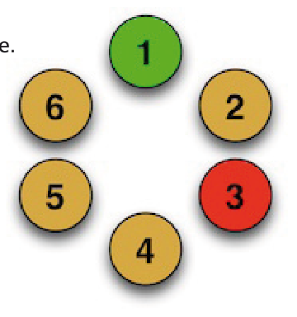

Das Abzählen geht bei den Bibern so: Wer mit Abzählen an der Reihe ist, beginnt bei sich selbst und zählt den Kreis im Uhrzeigersinn durch, einen Biber pro Silbe des Abzählreims. Der mit der letzten Silbe erreicht wird, muss den Kreis verlassen. Das neue Abzählen beginnt beim nächsten Biber im Kreis. Wenn der Biber, der gezählt hat, selbst raus muss, kommt der nächste Biber im Kreis mit Abzählen an die Reihe.

Sechs Biber stehen im Kreis und spielen Abzählen. Ihr Abzählreim hat neun Silben. Biber 1 ist mit Abzählen an der Reihe, fängt also bei sich an zu zählen. Biber 3 muss nach neun Silben als erster raus. Das neue Abzählen beginnt also bei Biber 4.

**In welcher Reihenfolge verlassen die Biber den Kreis?**
