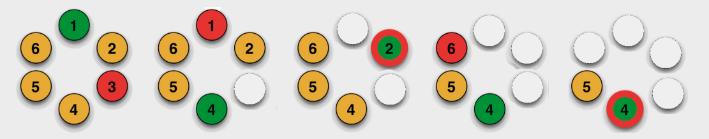

Und so wurde abgezählt:

Da es nur eine mögliche richtige Reihenfolge gibt, müssen die anderen Antworten falsch sein.

## Das ist Informatik!

Das Abzählen läuft nach dem beschriebenen „Algorithmus“ ab. So nennt man in der Informatik präzise Anweisungsfolgen, um Berechnungen auszuführen oder Strukturen umzubauen. Der Abzählalgorithmus gilt nicht nur für den einen besonderen Fall (sechs Biber und ein neunsilbiger Abzählreim), sondern auch im Allgemeinen, für beliebige Anzahlen von Bibern und Reimsilben. Der Abzählalgorithmus berechnet eine „Josephus-Permutation“ der Zahlen 1 bis n. <http://de.wikipedia.org/wiki/Josephus-Problem>
