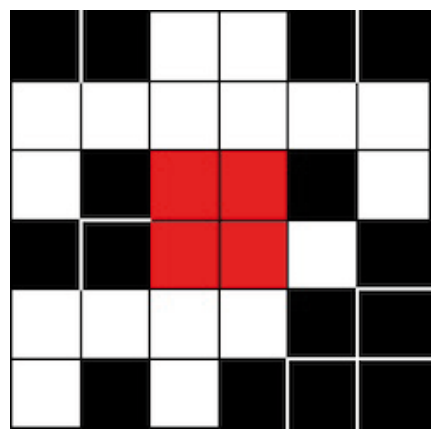

Die Informatik-Biber kennzeichnen ihre gefällten Bäume. Ein Kennzeichen besteht aus einer Matrix von 6 mal 6 Feldern, die schwarz oder weiß sein können.

Bei jedem Kennzeichen ist in jeder Reihe und in jeder Spalte die Anzahl der schwarzen Felder immer gerade. So ist das Kennzeichen in der rauen Umgebung etwas robuster.

Dieses Kennzeichen wurde beim Baumtransport verschmutzt:

**Wie sahen die vier roten Felder vorher aus?**
