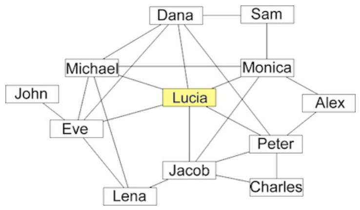

Lucia ist bei einem sozialen Netzwerk registriert. Die Grafik zeigt die sogenannten „friends“ von Lucia und deren „friends“:

Eine Linie bedeutet, dass die beiden Personen „friends“ sind. Zum Beispiel ist Monica Lucias „friend“ und Lucia ist Monicas „friend“, aber Alex ist (noch) nicht Lucias „friend“.

Wenn jemand einen „friend“ ein Foto sehen lässt, darf dieser „friend“ das Foto kommentieren. Wenn jemand ein Foto kommentiert, bekommen dessen „friends“ den Kommentar und auch das Foto zu sehen. Diese „friends“ dürfen so ein Foto aber nur dann kommentieren, wenn sie es schon kommentieren durften, bevor sie es zu sehen bekamen.

Lucia hat ein Foto hochgeladen. Sie will aber nicht, dass Jacob es zu sehen bekommt. Sie ist sicher, dass Jacob unter ihren „friends“ keinen neuen „friend“ mehr finden wird.

**Wen könnte sie das Foto sehen lassen?**
