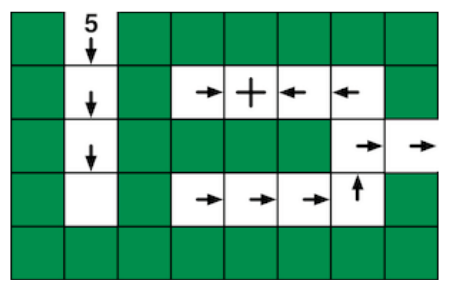
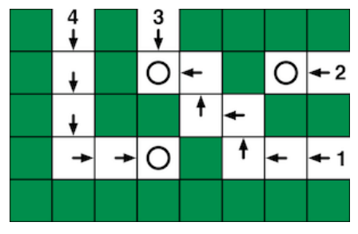

Ein Biber möchte seinen Bau zur Sicherheit als Labyrinth anlegen. Sein Bauplan zeigt die beiden Etagen seines Baus als Raster von quadratischen Feldern. Die weißen Felder bilden die Gänge.

Der Bauplan zeigt, wie man sich in den Gängen von Feld zu Feld bewegen darf:

- Von einem Feld mit Pfeil geht man zum nächsten Feld in Richtung des Pfeils.
- Von einem Feld mit Kreis geht man zum darunter liegenden Feld der unteren Etage.
- Von einem Feld mit Kreuz geht man zum darüber liegenden Feld der oberen Etage.
- Von einem Feld ohne Zeichen geht es nicht weiter.

Der Bauplan zeigt fünf Eingänge und in der unteren Etage einen Ausgang. Leider ist der Bauplan unbrauchbar: Nur von einem der Eingänge aus kann der Biber auch den Ausgang erreichen.

**Gib die Nummer dieses Eingangs hier ein (als Zahl):**
