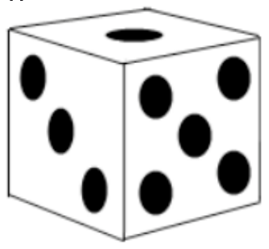

Ein Spielwürfel hat 6 Seiten. Auf den Würfelseiten sind schwarze Punkte, die Würfelaugen. Die Augenzahlen gehen von 1 bis 6, jede kommt nur einmal vor.

Die Summe von gegenüberliegenden Augenzahlen ist stets 7.

Ein Spielwürfel kann als „Graph“ dargestellt werden. Ein Graph hat Knoten und Kanten. Die Knoten stellen die Seiten des Würfels dar, mit den Augenzahlen in kleinen Kreisen. Die Kanten stellen mit Linien dar, welche Seiten des Würfels aneinander grenzen.

**Welcher Graph entspricht einem Spielwürfel?**
