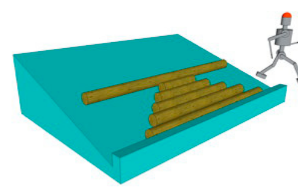

Hilfe! Roboter Alan sortiert Baumstämme. Aber wir wissen nicht mehr genau, wie er programmiert wurde.

Auf dem Boden liegen mehrere Baumstämme von unterschiedlicher Länge. Alan wählt nach einer bestimmten Vorschrift einen Baumstamm aus, legt ihn oben auf die Rampe und lässt ihn hinunter rollen. Das wiederholt Alan so lange, bis keine Baumstämme mehr auf dem Boden liegen. Schau dir das Ergebnis an:

**Nach welcher Vorschrift hat Alan die Baumstämme ausgewählt?**
