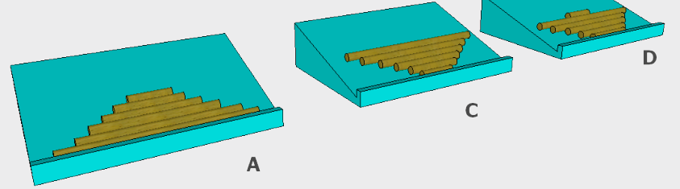

Antwort B ist richtig.

Nach Vorschrift B muss auf der Rampe zuunterst der zweitlängste Baumstamm liegen, darüber der zweitlängste der verbleibenden Baumstämme usw. Die Baumstämme werden zunächst nach oben hin kürzer. Der längste Baumstamm kommt dann ganz zum Schluss dran und liegt deshalb auf der Rampe zuoberst. Die anderen Vorschriften führen zu folgenden Ergebnissen (A, C und D):

## Das ist Informatik!

In der Aufgabe geht es um das Sortieren, genauer gesagt um die Variante „Sortieren durch direkte Auswahl“. Sortierverfahren sind ein wichtiges Gebiet der Informatik. Viele Programme enthalten irgendwelche Sortier-Algorithmen. Deren Vorschriften hängen vom Programm-Zweck ab und können auch mal sehr ungewöhnlich sein.
