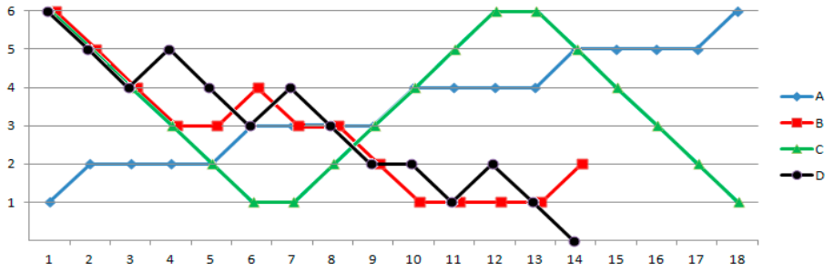

Antwort D ist richtig.



Selbst wenn man die Melodie D (schwarze Linie) mit dem höchstmöglichen Ton beginnt, kann man ihren letzten Ton nicht spielen. Der vorletzte Ton ist schon der tiefstmögliche. Auf der Bebrocarina kann man keine Melodien spielen, die einen Tonumfang von mehr als 6 Tönen haben. Den Tonumfang für einen beliebigen Melodieabschnitt oder die ganze Melodie rechnet man so aus:

Tonumfang = (Anfangston − Höhenminimum + Höhenmaximum)

Hier das durchgerechnete Beispiel einer nicht spielbaren Melodie mit einem Tonumfang von 8 Tönen:

```
Melodie:[ -  -  +  +  o  +  +  +  o  -  +  +  o  +  -  o  ]
Höhe:     0 -1 -2 -1  0  0  1  2  3  3  2  3  4  4  5  4  4
Tonumfang:1  2  3  3  3  3  4  5  6  6  6  6  7  7  8  8  8
```

Melodie A hat übrigens einen Tonumfang von 6 Tönen, die Melodien B und C einen Tonumfang von 5 Tönen.

## Das ist Informatik!

Um eine Information zu übermitteln oder zu speichern, muss sie mit Hilfe einer Menge von Zeichen codiert werden. Beispiele für Codes und die zugehörigen Zeichenmengen sind unsere Schriftsprache mit ihren Buchstaben oder der Morsecode mit den drei Tonsignalen „kurz“, „lang“ und „Pause“.

Für Musik gibt es zum Beispiel mit der modernen westlichen Notenschrift einen sehr ausdifferenzierten Code. Wenn aber Informationen wie die Melodien der Bebrocarina einfach strukturiert sind, kann ein Code mit wenigen Zeichen auskommen. Im Computer werden alle Informationen mit nur zwei Zeichen beschrieben – und damit doch beliebige Informationen wie Texte, Bilder, Töne, Filme und vieles andere mehr übermittelt. Der Trick der Informatik ist es, Folgen dieser zwei Zeichen zu Blöcken zusammenzufassen und so weitere Beschreibungsmöglichkeiten zu erzeugen. Z. B. erhält man bei Blöcken der Länge 8 (auch als Bytes bezeichnet) eine Menge von 2 hoch 8 = 256 verschiedener Zeichen.
