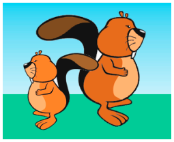

Ein großer und ein kleiner Biber pflanzen Blumen im Garten. Der kleine Biber hat kürzere Arme und kürzere Beine als der große Biber. Deshalb macht der kleine Biber auch kürzere Schritte als der große Biber, und er pflanzt auch die Blumen näher beieinander.



Am Anfang stehen sie Rücken an Rücken auf dem Rasen und schauen in entgegengesetzte Richtungen. Dann bewegen sich beide nach diesen Anweisungen:

```
wiederhole zwei Mal:
    pflanze eine Blume auf deiner rechten Seite
    gehe einen Schritt vorwärts
    pflanze eine Blume auf deiner linken Seite
    gehe einen Schritt vorwärts
```

**Wie sieht anschließend der Rasen aus?**
