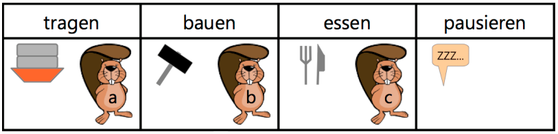
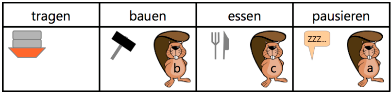
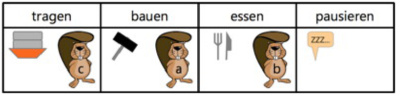

Drei Biber, mit „a“, „b“ und „c“ auf dem Bauch, bauen einen Damm, angeführt von ihrem Chef. Sie können mit je einer der vier Aufgaben „tragen“, „bauen“, „essen“ und „pausieren“ beschäftigt sein. Immer nur ein Biber kann mit einer dieser Aufgaben beschäftigt sein.

Anfangs sind die Biber mit den folgenden Aufgaben beschäftigt:

Nun gibt der Chef die Anweisung „tragen → pausieren“. Damit meint er, dass der Biber, der gerade am Tragen war, nun pausieren soll. Nach dieser Anweisung sind die Biber mit den folgenden Aufgaben beschäftigt:

Der Chef gibt nun einige weitere Anweisungen, die von den Bibern gewissenhaft ausgeführt werden. Danach sind die Biber mit den folgenden Aufgaben beschäftigt:

**Welche weiteren Anweisungen hat der Chef gegeben?**
