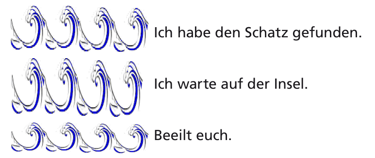
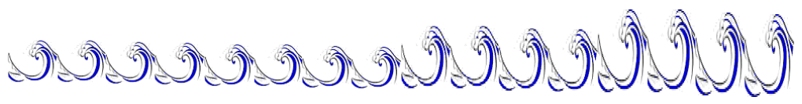

Wir befinden uns im 18. Jahrhundert. Popeye der Seemann hat auf einer karibischen Insel eine Schatzkiste gefunden und möchte nun seine Freunde auf dem Festland benachrichtigen. Sobald Popeye Spinat gegessen hat, ist er bekanntlich sehr stark und kann auf dem Meer unterschiedliche Wellen erzeugen. Seine Freunde wissen, was die folgenden Wellen zu bedeuten haben:

Popeye isst eine Dose Spinat und schickt seinen Freunden eine Nachricht, indem er diese Welle erzeugt:

**Was bedeutet diese Nachricht?**
