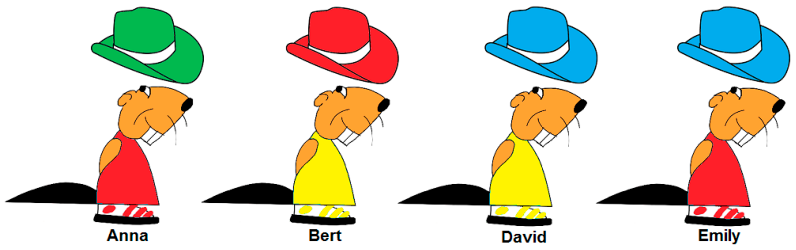

Anna, Bert, David und Emily Biber haben bei ihrer Kleiderwahl zwei Regeln:

- Sie tragen normalerweise einen Hut mit ihrer Lieblingsfarbe.
- Sie tragen dazu ein Hemd, das nicht die gleiche Farbe wie der Hut hat.

Eben haben sie aber ihre Hüte zum Spaß untereinander getauscht. Jetzt tragen alle vier einen Hut, der nicht die Lieblingsfarbe hat.

**Welcher Biber trägt normalerweise den grünen Hut?**
