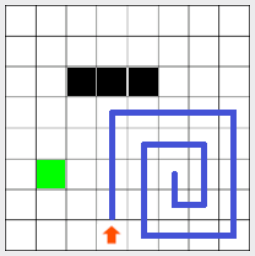
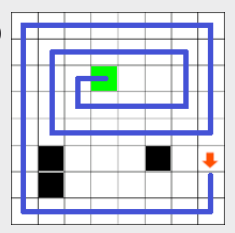
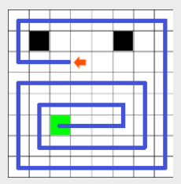
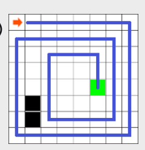

Antwort C ist richtig: Auf dem Spielbrett C erreicht der Roboter nicht sein Ziel. Er klemmt sich in seinem eigenen Fahrweg ein, dessen Felder ja alle sofort zu Hindernissen werden:

Bei den anderen Spielbrettern erreicht der Roboter sein Ziel:

  

## Das ist Informatik!

Algorithmen sind ein grundlegendes Thema der Informatik. Sie beschreiben, wie ein gewisses „Problem“ (hier das Erreichen des Zielfelds) gelöst werden kann. Dabei ist es erstrebenswert, dass ein Algorithmus immer zum Ziel führt, wenn es überhaupt möglich ist. Wenn schon am Anfang die Hindernisse eine dichte Mauer bilden, hilft natürlich kein noch so guter Algorithmus. Aber dass der Roboter sich selbst manchmal den Weg abschneidet, muss wirklich nicht sein. Der hier benutzte Algorithmus ist für das Problem des Erreichens des Ziels also wenig geeignet. Unser armer Roboter sollte mit einem besseren programmiert werden. Vielleicht schon beim nächsten Bundeswettbewerb Informatik?
