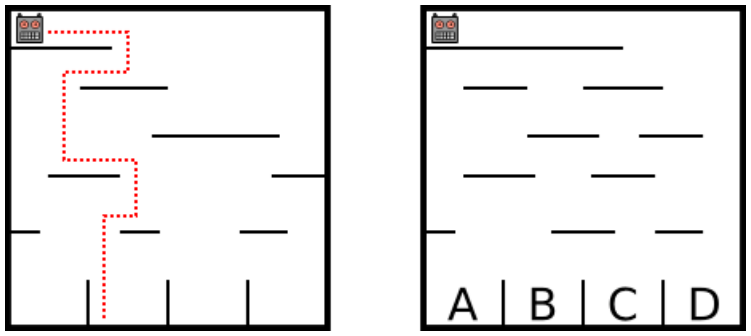

Ein Roboter läuft durch ein senkrecht stehendes Labyrinth. Er fällt dabei von einer Plattform auf eine darunter liegende. Nachdem er dort gelandet ist, ändert er seine Richtung. Am Schluss landet er ganz unten in einem der Fächer (siehe linkes Bild).

**In welchem Fach landet der Roboter im rechten Bild?**
