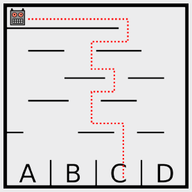

Antwort C ist richtig.

## Das ist Informatik!

Der Roboter befolgt eine einfache Vorschrift, die seinen Weg zum Ziel beschreibt. Solche Vorschriften – oder auch ganze Folgen von Vorschriften – werden in der Informatik Algorithmen genannt.

Algorithmen sind aber nicht immer so einfach wie hier, sondern können ganz schön kompliziert aussehen. Es ist aber nicht so, dass man mit komplizierteren Algorithmen im Allgemeinen auch kompliziertere Probleme lösen kann. Im Gegenteil gelten in der Informatik einfache Algorithmen für komplizierte Probleme als besonders elegant.

Algorithmen nachvollziehen und vor allem selbst ausdenken und programmieren zu können ist eine wichtige Fähigkeit, die Informatikerinnen und Informatiker beherrschen müssen.
