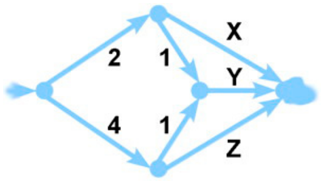

Im Bibertal gabelt sich der Fluss auf dem Weg von der Quelle zum See mehrmals. Mit Hilfe von geschickt gebauten Dämmen können die Biber die Wassermengen in den einzelnen Flussarmen regulieren und maximieren.

Bei einer Gabelung wird die durchfließende Wassermenge auf beide Flussarme aufgeteilt. Im Bild steht neben den Flussarmen (Pfeile), welche Wassermenge pro Sekunde maximal durchfließen kann.

**Wie müssen die Durchflüsse X, Y und Z reguliert werden, damit eine maximale Wassermenge in den See fließt?**
