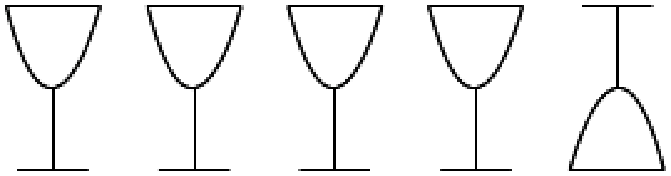

Auf dem Tisch stehen fünf leere Gläser. Eines steht falsch herum (auf dem Kopf). Die anderen vier Gläser stehen richtig herum.

In einem Spiel sollst du erreichen, dass alle Gläser richtig herum stehen. Du musst aber mit jedem Spielzug immer genau drei dieser Gläser umdrehen.

**Wie viele Spielzüge brauchst du mindestens, bis alle Gläser richtig herum stehen?**
