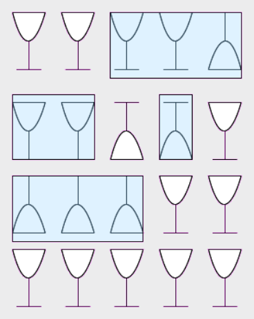

Antwort B ist richtig.

## Das ist Informatik!

Der Versuch, ein solches Problem durch wildes Herumprobieren (trial and error) zu lösen, hilft nicht bei der Frage, wie viele Spielzüge man mindestens braucht. Probiert man dagegen alle Spielzug-Möglichkeiten systematisch durch (brute force), bekommt man zwar garantiert die Lösung – es könnte aber sehr lange dauern, wenn es viele Möglichkeiten sind.

Gelingt es aber, das Problem auf sein Wesentliches zu reduzieren, ist die Lösung oft direkt zu sehen. Hier ist das Wesentliche, wie man unabhängig von einzelnen Gläsern am einfachsten vom Zustand „4 richtig“ zum Zustand „2 richtig“ kommt.

Menschen mit „Durchblick“ sind in der Informatik sehr gefragt.
