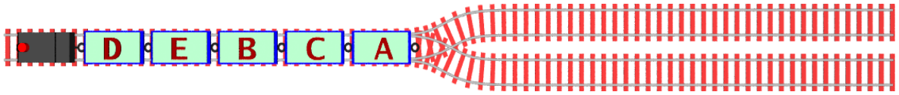
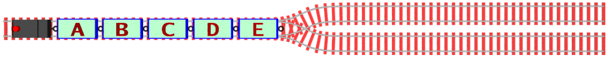

Der Güterzug der Biberbahn wurde in der Wagenreihung D-E-B-C-A abgestellt:

Die Lok kann vorwärts und rückwärts fahren und dabei beliebig viele Waggons ziehen und schieben. Jedes Mal, wenn ein Waggon angekoppelt oder ein Waggon abgekoppelt wird, zählt das als eine Rangieroperation.

**Wie viele Rangieroperationen sind mindestens nötig, um die Wagenreihung A-B-C-D-E herzustellen?**

