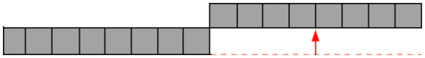
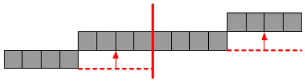

Ein Papierstreifen ist in 16 gleich lange Stücke eingeteilt:

So einen 16er-Streifen kann man wunderbar „halbetzen“. Dazu muss man den Streifen halbieren und dann die rechte Hälfte um eine Streifenbreite nach oben versetzen:

Nun geht es weiter, und man muss die beiden entstandenen 8er-Streifen selbst wieder halbetzen. Der nächste Schritt ist also:

Danach werden zuerst die 4er-Streifen und anschließend die entstandenen 2er-Streifen halbetzt. Dann ist Schluss, denn 1er-Streifen sind nicht halbetzbar.

**Was ist am Schluss aus dem 16er-Streifen geworden?**
