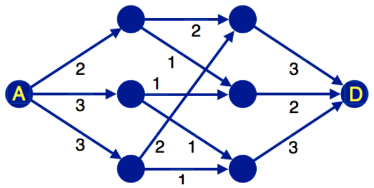

Im Wald (A) liegt ein Gebiet, wo die Biber Bäume für ihre Dämme fällen. Die Stämme transportieren sie auf dem Wasserweg über ein System von Kanälen zu ihrem neuen Projekt, dem größten Staudamm aller Zeiten (D). Die Pfeile stellen die Kanäle dar, die Punkte sind Verzweigungen beziehungsweise Zusammenflüsse. Jeder Kanal hat eine begrenzte Kapazität.

Pro Minute kann nur eine bestimmte Höchstzahl von Stämmen transportiert werden. Das bezeichnen die Zahlen an den Pfeilen.

**Wie viele Baumstämme können den Damm pro Minute höchstens erreichen?**
