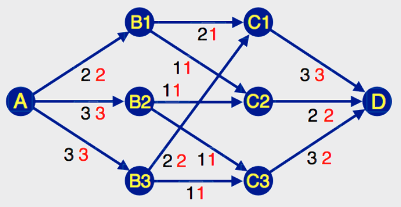

Die Höchstzahl 7 ist richtig.

Wenn ein Kanal K eine bestimmte Kapazität x hat, heißt das noch nicht, dass in dem Kanalsystem tatsächlich x Baumstämme pro Minute über den Kanal K transportiert werden können. Denn vor dem Kanal K könnte eine Engstelle sein, die verhindert, dass die volle Kapazität erreicht wird. Das Bild zeigt eine optimale Verteilung, nach der die Baumstämme durch das Kanalsystem treiben können. Die roten Zahlen stellen tatsächliche Anzahlen transportierter Baumstämme dar. Jede rote Zahl ist höchstens so groß wie die Kanalkapazität, manchmal aber auch kleiner. Zum Beispiel können von C3 nach D pro Minute nur 2 Baumstämme treiben (obwohl die Kapazität 3 ist), weil in C3 nur zwei Baumstämme pro Minute ankommen. Das Ergebnis kann man ganz rechts an den Kanälen, die zu D führen, ablesen. Die Anzahl der Baumstämme, die pro Minute ankommen können, ist n = 3 + 2 + 2 = 7.

## Das ist Informatik!

Das Berechnen des „maximalen Flusses durch ein Netzwerk mit Kapazitäten“ ist Beispiel für eine in der Praxis häufige Optimierungsaufgabe. Bei unserer einfach zu überschauenden Aufgabenstellung lässt sich mit ein wenig Probieren die Lösung finden. Man kann sich aber vorstellen, dass bei größeren Netzwerken sehr systematisch vorgegangen werden muss – mit einem Algorithmus, dessen Korrektheit bewiesen wurde. Die Informatik hat ganze Bibliotheken vertrauenswürdiger Algorithmen für alle möglichen praktischen Anwendungen wissenschaftlich vorbereitet.
