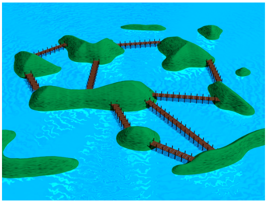
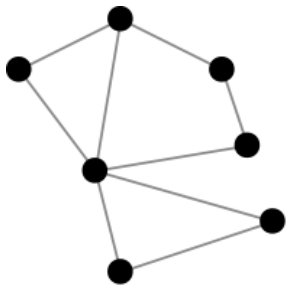

Die Siedlungen der Dau sind auf verschiedene Inseln verteilt. Also möchten sie Brücken bauen, um sich besser austauschen zu können. Ein Dau-Ingenieur hat einen Plan gezeichnet, auf dem die Inseln als Punkte und die Brücken als Linien dargestellt sind:

 

Seine Dau-Arbeiter möchten aber einen Plan haben, auf dem die Brücken als Punkte und die Inseln als Linien dargestellt sind.

**Wie sieht dieser Plan aus?**
