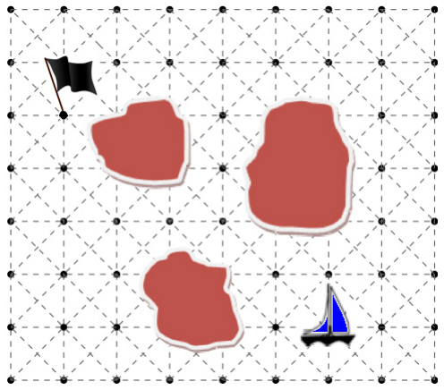
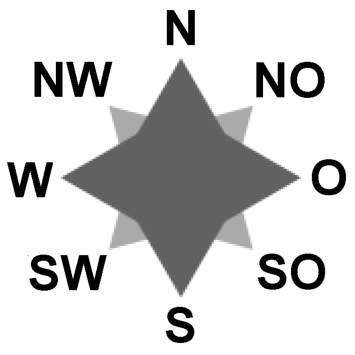

Die Piratenbiber segeln durch ein Inselgebiet. Ihr Ziel ist auf einem der Rasterpunkte ihrer Seekarte durch eine schwarze Flagge markiert. Eine programmierbare Steuerung kann das Segelschiff von Punkt zu Punkt bewegen. Dabei hält sie stets Kurs in einer der acht Richtungen der Windrose. Zum Beispiel bedeutet „1N“ eine Bewegung zum nächsten Punkt in nördlicher Richtung. Und „2SW ; 1S“ bedeutet zwei Bewegungen zum übernächsten Punkt in südwestlicher Richtung und dann eine dritte Bewegung in südlicher Richtung.

 

**Welches Steuerprogramm führt ohne Zusammenstoß mit einer Insel und mit möglichst wenigen Bewegungen zum Zielpunkt?**
