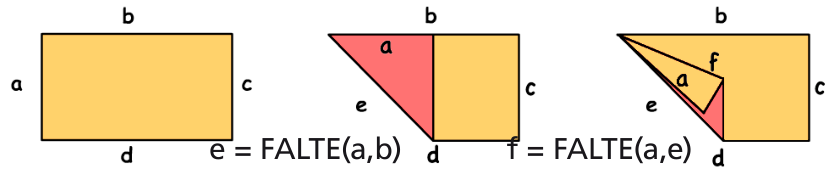
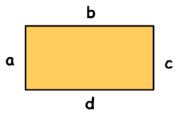

Die Biber haben eine Sprache des Papierfaltens entworfen. Mit der Sprache können sie beschreiben, wie man ein Stück Papier mit geraden Kanten falten soll. Die Anweisungen in dieser Sprache heißen FALTE. `z = FALTE(x,y)` bedeutet zum Beispiel: Falte das Stück Papier so, dass seine Kante x genau auf seiner Kante y zu liegen kommt. Auf diese Weise entsteht eine neue Kante. Diese wird z genannt. Ein Beispiel mit zwei Anweisungen hintereinander:

Denk dir nun ein rechteckiges Papier, dessen Kante b zweimal so lang ist wie seine Kante a. Lass das Papier während des Faltens auf dem Tisch liegen (nicht wenden). Führe diese drei Anweisungen nacheinander aus:

`e = FALTE(c,a); f = FALTE(c,d); g = FALTE(a,f)`

**Wie sieht das Papier danach aus?**
